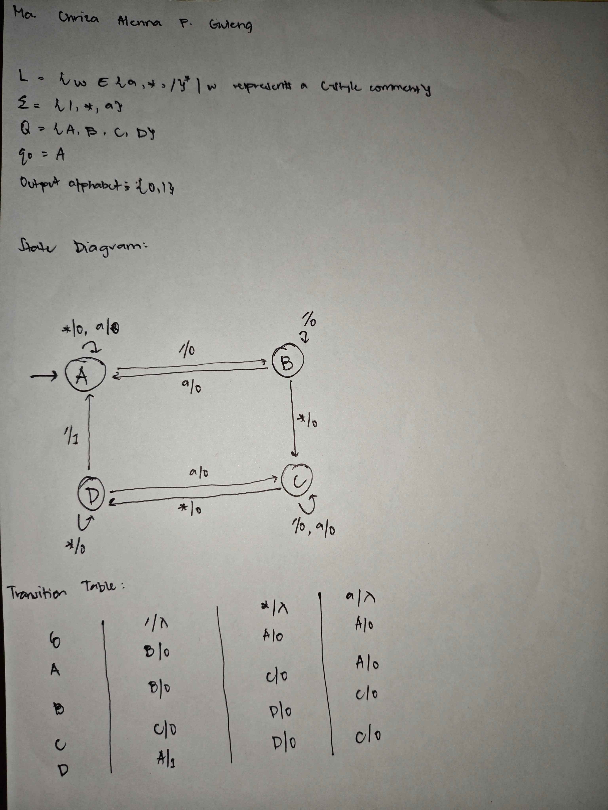
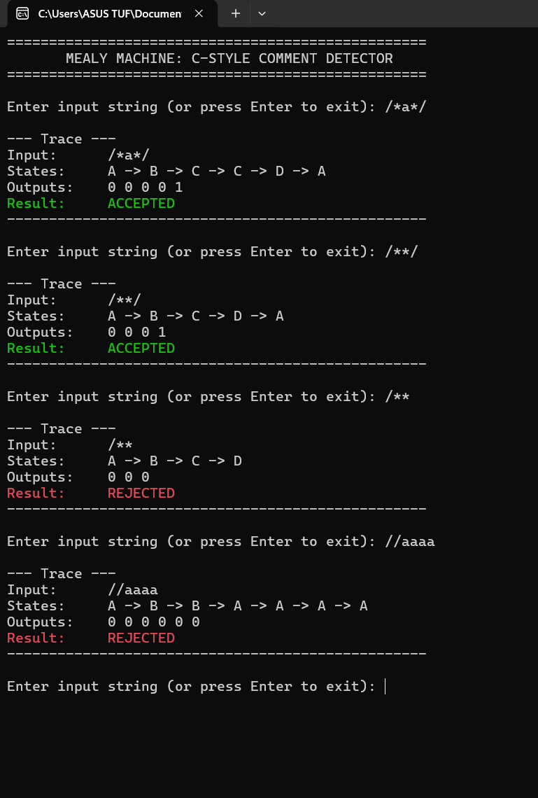

# Mealy Machine Demonstration & Tester

A finite-state machine implementation of a **Mealy Machine** that detects and validates C-style comments (`/* ... */`) in C#.

## Transition Table
Transitions are formatted as **$\text{Next State} / \text{Output}$**:
| Present State ($q$) | Input: $/\;/\;\lambda$ | Input: $*\;/\;\lambda$ | Input: $a\;/\;\lambda$ |
| :---: | :---: | :---: | :---: |
| $\rightarrow A$ | $B / 0$ | $A / 0$ | $A / 0$ |
| $B$ | $B / 0$ | $C / 0$ | $A / 0$ |
| $C$ | $C / 0$ | $D / 0$ | $C / 0$ |
| $D$ | **$A / 1$** | $D / 0$ | $C / 0$ |

## Handwritten Work (Bond Paper)

## Program Execution Output
# Input Tester Ouput:

